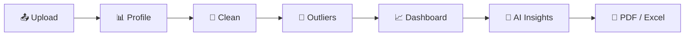

<!-- ====================================================== -->
<!--                    ANIMATED HEADER                     -->
<!-- ====================================================== -->

  

  

---

<!-- ====================================================== -->
<!--                       ABOUT ME                         -->
<!-- ====================================================== -->

## 👨‍💻 ABOUT ME

Hello! 👋 I'm **Sanket Santosh Mane**, a BCA graduate passionate about Data Analytics, Business Intelligence, and Technology.

I enjoy working with data, discovering meaningful patterns, and transforming complex datasets into actionable business insights.

* 🎓 BCA Graduate – 2025
* 📊 Aspiring Data Analyst
* 🐍 Python & SQL Enthusiast
* 📈 Power BI Dashboard Developer
* 📑 Excel & Data Visualization
* 💾 Database Management & Query Optimization
* 🔍 Exploratory Data Analysis (EDA)
* 🧭 Creator of **DataPilot AI**, an AI-powered data cleaning & analytics platform
* 🚀 Passionate about real-world data projects

**My Goal:** To build a career in Data Analytics by using SQL, Python, Excel, and Power BI to solve business problems and support data-driven decision-making.

 

---

<!-- ====================================================== -->
<!--                  SPOTLIGHT PROJECT                     -->
<!-- ====================================================== -->

## ⭐ SPOTLIGHT: DATAPILOT AI

### 🧭 Automated Data Cleaning & Analytics Platform

*Upload a messy CSV or Excel file and get a clean dataset, an interactive dashboard, AI insights, and a PDF/Excel report.*

  

 

| What it does | How |
| --- | --- |
| 📊 **Profiles any dataset** | Missing values, duplicates, type problems, and a transparent **data quality score** |
| 🧹 **Cleans with your approval** | Preview → approve → apply, with undo, reset, and a full cleaning log. The original file is never modified |
| 🎯 **Finds outliers** | IQR, Z-score, and Isolation Forest, with keep / remove / cap options |
| 📈 **Builds dashboards automatically** | Charts, KPIs, and filters chosen from column types, so it works on any dataset |
| 🤖 **Writes insights** | Google Gemini sees only aggregated statistics (never raw rows), with a full offline mode |
| 📄 **Exports reports** | Downloadable PDF and multi-sheet Excel reports |

**Built with:**

---

<!-- ====================================================== -->
<!--                    TECHNICAL SKILLS                    -->
<!-- ====================================================== -->

## 🛠️ TECH STACK & TECHNOLOGIES

### 💻 Programming Languages & Database

### 📊 Data Analytics & Visualization

### 🔧 Development Tools

### 🧠 Technical Competencies

| Category              | Skills                                                  |
| --------------------- | ------------------------------------------------------- |
| Programming           | Python, SQL                                             |
| Python Libraries      | Pandas, NumPy, Matplotlib, Seaborn, Plotly              |
| Python Apps           | Streamlit (multi-page data apps), modular code, Pytest  |
| Machine Learning      | Scikit-learn (Isolation Forest for outlier detection)   |
| AI Integration        | Google Gemini API (privacy-safe, aggregates only)       |
| SQL                   | Joins, CTEs, Subqueries, Aggregations, Window Functions |
| Advanced SQL          | CASE Statements, Stored Procedures, Query Optimization  |
| Power BI              | DAX, Power Query, KPI Dashboards                        |
| Excel                 | Pivot Tables, VLOOKUP, XLOOKUP, INDEX-MATCH             |
| Databases             | SQL Server, MySQL, SQLite, SSMS                         |
| Analytics             | EDA, Data Cleaning, Data Wrangling, Data Validation     |
| Business Intelligence | KPI Analysis, Trend Analysis, Outlier Analysis          |
| Tools                 | Jupyter Notebook, VS Code, Git, GitHub                  |

---

<!-- ====================================================== -->
<!--                  ANALYTICS WORKFLOW                    -->
<!-- ====================================================== -->

## ⚙️ MY DATA ANALYTICS
