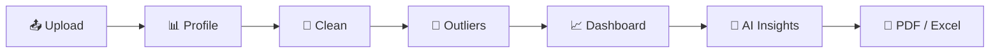

<!-- ====================================================== -->
<!--                    ANIMATED HEADER                     -->
<!-- ====================================================== -->

  

  

---

<!-- ====================================================== -->
<!--                       ABOUT ME                         -->
<!-- ====================================================== -->

## 👨‍💻 ABOUT ME

Hello! 👋 I'm **Sanket Santosh Mane**, a BCA graduate passionate about Data Analytics, Business Intelligence, and Technology.

I enjoy working with data, discovering meaningful patterns, and transforming complex datasets into actionable business insights.

* 🎓 BCA Graduate – 2025
* 📊 Aspiring Data Analyst
* 🐍 Python & SQL Enthusiast
* 📈 Power BI Dashboard Developer
* 📑 Excel & Data Visualization
* 💾 Database Management & Query Optimization
* 🔍 Exploratory Data Analysis (EDA)
* 🧭 Creator of **DataPilot AI**, an AI-powered data cleaning & analytics platform
* 🚀 Passionate about real-world data projects

**My Goal:** To build a career in Data Analytics by using SQL, Python, Excel, and Power BI to solve business problems and support data-driven decision-making.

 

---

<!-- ====================================================== -->
<!--                  SPOTLIGHT PROJECT                     -->
<!-- ====================================================== -->

## ⭐ SPOTLIGHT: DATAPILOT AI

### 🧭 Automated Data Cleaning & Analytics Platform

*Upload a messy CSV or Excel file and get a clean dataset, an interactive dashboard, AI insights, and a PDF/Excel report.*

  

 

| What it does | How |
| --- | --- |
| 📊 **Profiles any dataset** | Missing values, duplicates, type problems, and a transparent **data quality score** |
| 🧹 **Cleans with your approval** | Preview → approve → apply, with undo, reset, and a full cleaning log. The original file is never modified |
| 🎯 **Finds outliers** | IQR, Z-score, and Isolation Forest, with keep / remove / cap options |
| 📈 **Builds dashboards automatically** | Charts, KPIs, and filters chosen from column types, so it works on any dataset |
| 🤖 **Writes insights** | Google Gemini sees only aggregated statistics (never raw rows), with a full offline mode |
| 📄 **Exports reports** | Downloadable PDF and multi-sheet Excel reports |

**Built with:**

---

<!-- ====================================================== -->
<!--                    TECHNICAL SKILLS                    -->
<!-- ====================================================== -->

## 🛠️ TECH STACK & TECHNOLOGIES

### 💻 Programming Languages & Database

### 📊 Data Analytics & Visualization

### 🔧 Development Tools

### 🧠 Technical Competencies

| Category              | Skills                                                  |
| --------------------- | ------------------------------------------------------- |
| Programming           | Python, SQL                                             |
| Python Libraries      | Pandas, NumPy, Matplotlib, Seaborn, Plotly              |
| Python Apps           | Streamlit (multi-page data apps), modular code, Pytest  |
| Machine Learning      | Scikit-learn (Isolation Forest for outlier detection)   |
| AI Integration        | Google Gemini API (privacy-safe, aggregates only)       |
| SQL                   | Joins, CTEs, Subqueries, Aggregations, Window Functions |
| Advanced SQL          | CASE Statements, Stored Procedures, Query Optimization  |
| Power BI              | DAX, Power Query, KPI Dashboards                        |
| Excel                 | Pivot Tables, VLOOKUP, XLOOKUP, INDEX-MATCH             |
| Databases             | SQL Server, MySQL, SQLite, SSMS                         |
| Analytics             | EDA, Data Cleaning, Data Wrangling, Data Validation     |
| Business Intelligence | KPI Analysis, Trend Analysis, Outlier Analysis          |
| Tools                 | Jupyter Notebook, VS Code, Git, GitHub                  |

---

<!-- ====================================================== -->
<!--                  ANALYTICS WORKFLOW                    -->
<!-- ====================================================== -->

## ⚙️ MY DATA ANALYTICS WORKFLOW

My approach to solving data problems:

1. **Data Collection:** Gather and understand raw datasets.
2. **Data Cleaning:** Handle missing values, duplicates, and inconsistencies.
3. **Data Transformation:** Prepare structured datasets using Python, SQL, and Excel.
4. **Exploratory Data Analysis:** Identify patterns, trends, and relationships.
5. **Data Visualization:** Develop interactive dashboards using Power BI and Python.
6. **Business Insights:** Convert analytical findings into actionable insights.

---

<!-- ====================================================== -->
<!--                   MORE PROJECTS                        -->
<!-- ====================================================== -->

## 🚀 MORE PROJECTS

| # | Project | Tech Stack |
| - | ------- | ---------- |
| 1 | 📊 SalesPulse: Sales Performance & BI Dashboard | SQL, Python, Pandas, Excel, Power BI, DAX |
| 2 | 📢 Meta Ads Performance Analytics | Python, Pandas, NumPy, Matplotlib, Seaborn, Excel |
| 3 | 💳 Credit Card Financial Dashboard | Power BI, SQL, DAX |
| 4 | 🚕 Uber Booking Analysis Dashboard | Power BI, DAX, Data Modeling |
| 5 | 🏢 Function Hall Management System | PHP, MySQL, HTML, CSS, JavaScript, Bootstrap |
| 6 | 📦 Vendor Performance Analytics & Reporting | SQL, Python, Pandas, Power BI |

### 📊 1. SalesPulse – Sales Performance & Business Intelligence Dashboard

**Tech Stack:** SQL | Python | Pandas | Excel | Power BI | DAX

* Analyzed 5,000+ sales records to understand business performance.
* Used SQL Joins, CTEs, Subqueries, and Window Functions.
* Performed data cleaning and transformation.
* Developed interactive Power BI dashboards.
* Created KPIs for Revenue Growth, Profit Margin, and Average Order Value.

---

### 📢 2. Meta Ads Performance Analytics

**Tech Stack:** Python | Pandas | NumPy | Matplotlib | Seaborn | Excel

* Analyzed 10,000+ advertising records.
* Performed data cleaning and preprocessing.
* Explored campaign and advertising performance.
* Analyzed audience targeting attributes.
* Generated insights through Exploratory Data Analysis.

---

### 💳 3. Credit Card Financial Dashboard

**Tech Stack:** Power BI | SQL | DAX | Data Visualization

* Developed an interactive financial dashboard.
* Analyzed credit card transactions and customer data.
* Created financial KPIs and performance metrics.
* Visualized revenue and spending trends.
* Presented financial insights through interactive reports.

---

### 🚕 4. Uber Booking Analysis Dashboard

**Tech Stack:** Power BI | DAX | Data Modeling | Data Visualization

* Analyzed Uber booking and trip data.
* Developed an interactive Power BI dashboard.
* Created KPIs to monitor booking performance.
* Explored trip patterns and booking trends.
* Presented analytical findings through visualizations.

---

### 🏢 5. Function Hall Management System

**Tech Stack:** PHP | MySQL | HTML | CSS | JavaScript | Bootstrap

* Developed a database-driven hall booking management system.
* Implemented admin authentication.
* Managed customer and booking information.
* Created CRUD operations and reporting functionality.

---

### 📦 6. Vendor Performance Analytics & Reporting

**Tech Stack:** SQL | Python | Pandas | Power BI

* Analyzed vendor-level transaction data.
* Evaluated sales, revenue, and profitability.
* Performed data preparation and exploratory analysis.
* Developed interactive Power BI reports.
* Identified high-performing and low-performing vendors.

---

---

<!-- ====================================================== -->
<!--                  GITHUB STATISTICS                     -->
<!-- ====================================================== -->

## 📊 GITHUB STATISTICS

---

## 🔥 GITHUB CONTRIBUTION STREAK

---

## 🏆 GITHUB ACHIEVEMENTS

---

<!-- ====================================================== -->
<!--                    CONNECT WITH ME                     -->
<!-- ====================================================== -->

## 🌐 CONNECT WITH ME

  

📍 Pune, Maharashtra, India

### 💼 AREAS OF INTEREST

Data Analyst | Junior Data Analyst | SQL Developer | Power BI Developer | Python Developer

---

### 💚 THANK YOU FOR VISITING MY PROFILE!

**"Turning Raw Data into Meaningful Insights."**

⭐ Explore my repositories and feel free to connect!

